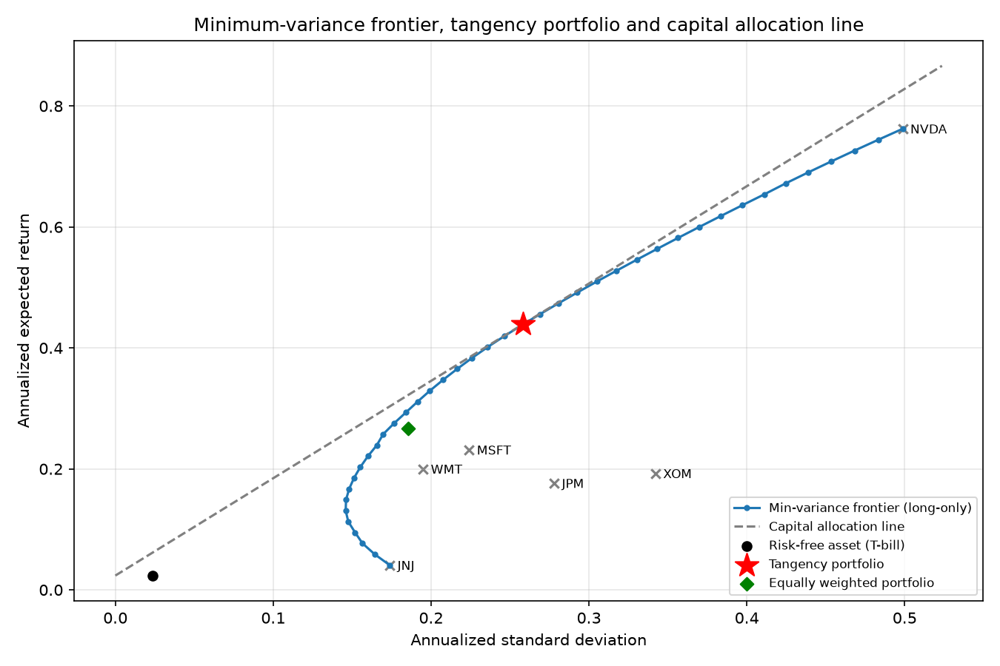

# Portfolio Optimisation



Portfolio construction using CAPM analysis. Hand picked six U.S.-listed common stocks selected from WRDS plus the one-month U.S. t-bills as the risk-free rate.

## Repository contents

| Path                    | Purpose                                                                             |
| ----------------------- | ----------------------------------------------------------------------------------- |
| `solution.ipynb`        | Main solution notebook                                                              |
| `fetch_data.py`         | Pulls the dataset directly from WRDS (CRSP) + Fama-French Data Library into `data/` |
| `data/crsp_monthly.csv` | CRSP monthly returns (columns: `PERMNO`, `Ticker`, `MthCalDt`, `MthRet`)            |
| `data/rf_monthly.csv`   | One-month T-bill rate (columns: `MthCalDt`, `Rf`)                                   |
| `output/`               | Generated outputs (Excel workbook, frontier chart)                                  |

## Setup

```powershell
# one-time: create the environment
python -m venv .venv
.venv\Scripts\python.exe -m pip install pandas numpy scipy matplotlib openpyxl jupyterlab nbconvert wrds
```

## Usage

```powershell
# 1. fetch the dataset (the first run prompts once for your WRDS username/password
#    and saves it to a local .env file so later runs are automatic; you can also
#    set WRDS_USERNAME / WRDS_PASSWORD environment variables instead)
.venv\Scripts\python.exe fetch_data.py

# 2. open the analysis
.venv\Scripts\jupyter.exe lab
```

Then open `solution.ipynb` and **Run All**. The notebook writes:

- `output/EF3320_Assignment1_Challenge.xlsx` — one sheet per task (returns, risk-free rate, asset statistics, equal-weight portfolio, tangency portfolio, frontier coordinates, efficient-vs-equal-weight comparison, floor allocation). Key answer rows are bolded.
- `output/frontier.png` — minimum-variance frontier + capital allocation line chart.

## Notes

- `ALLOW_SHORT = False` (top of the notebook) enforces long-only weights; set to `True` for an unconstrained frontier.
- Duplicated CRSP rows are dropped automatically in the load step.
