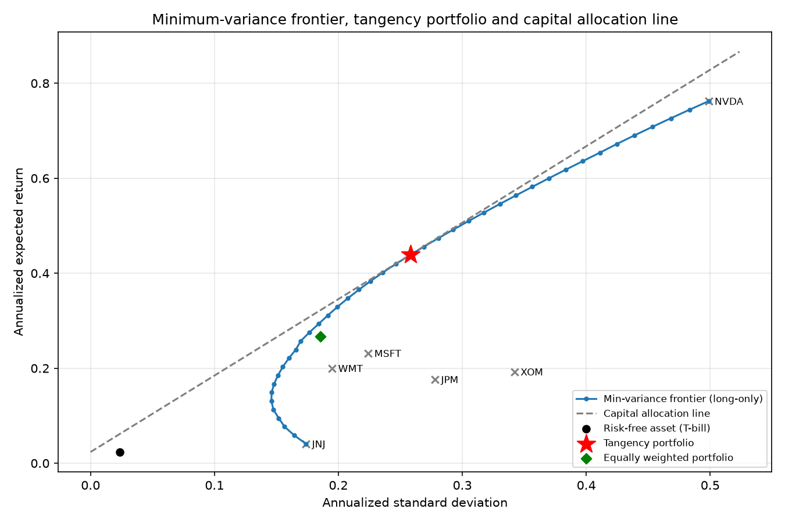

# Portfolio Optimisation

This repo covers some portfolio optimisation techniques

## Classical Analysis using CAPM



Portfolio construction using CAPM analysis. Hand picked six U.S.-listed common stocks selected from WRDS plus the one-month U.S. t-bills as the risk-free rate.

### Repository contents

| Path                    | Purpose                                                                             |
| ----------------------- | ----------------------------------------------------------------------------------- |
| `solution.ipynb`        | Main solution notebook                                                              |
| `fetch_data.py`         | Pulls the dataset directly from WRDS (CRSP) + Fama-French Data Library into `data/` |
| `data/crsp_monthly.csv` | CRSP monthly returns (columns: `PERMNO`, `Ticker`, `MthCalDt`, `MthRet`)            |
| `data/rf_monthly.csv`   | One-month T-bill rate (columns: `MthCalDt`, `Rf`)                                   |
| `output/`               | Generated outputs (Excel workbook, frontier chart)                                  |

### Setup

```powershell
# setup python venv and necessary libraries
python -m venv .venv

.venv\Scripts\python.exe -m pip install pandas numpy scipy matplotlib openpyxl jupyterlab nbconvert wrds

.venv\Scripts\activate
```

### Usage

```powershell
# 1. fetch data from WRDS, you need a WRDS subscription for this.
.venv\Scripts\python.exe fetch_data.py

# 2. run & open the analysis
.venv\Scripts\jupyter.exe lab
```

Then open `solution-arithmetic.ipynb` and `solution-geometric.ipynb` and **Run All**.

### Output

- `output/output.xlsx` — Two sheets, one for arithmetic results and one for geometric results.
- `output/frontier.png` — minimum-variance frontier + capital allocation line chart.

### Notes

- `ALLOW_SHORT = False` (top of the notebook) enforces long-only weights; set to `True` for an unconstrained frontier.
- Duplicated CRSP rows are dropped automatically in the load step.

## Monte Carlo Portfolio Optimisation

TODO

## Pairs Trading (Statistical Arbitrage)

TODO

## Moving Average Crossover Backtest

TODO
